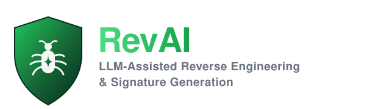
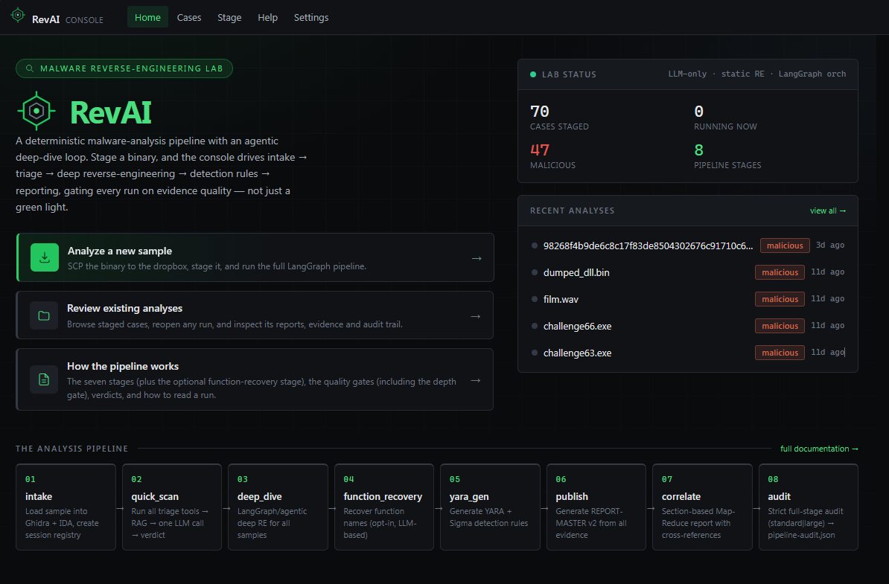
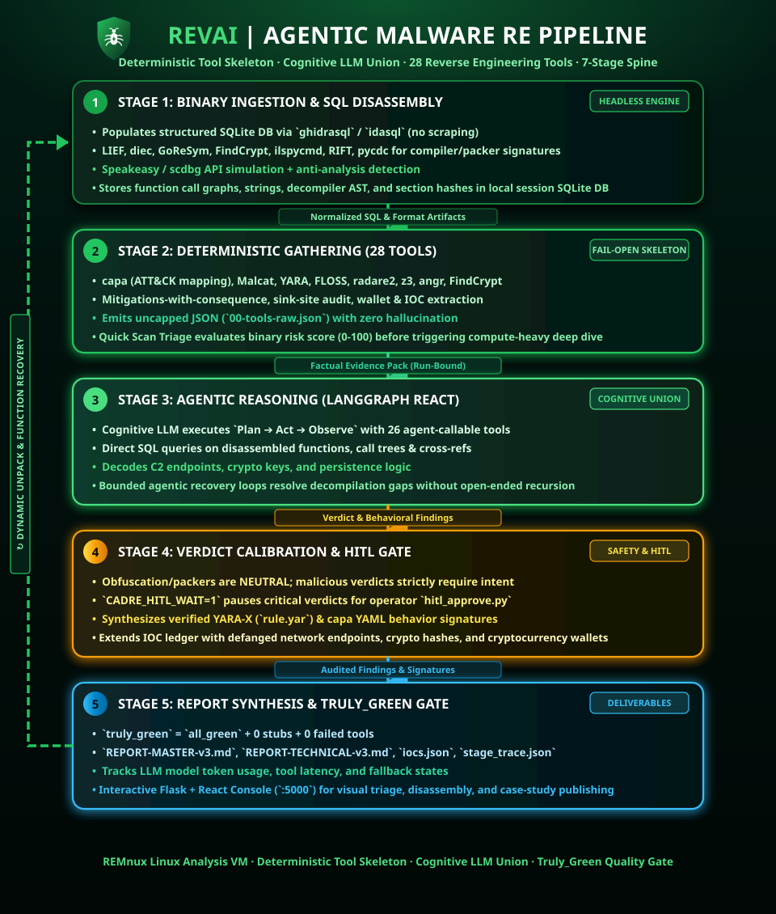

# RevAI

<p align="center">
  
</p>

<p align="center">
  <a href="https://github.com/Ganron007/RevAI"></a>
  <a href="https://github.com/Ganron007/RevAI"></a>
  <a href="https://github.com/Ganron007/RevAI"></a>
  <a href="https://doi.org/10.5281/zenodo.21613150"></a>
</p>

> **Malware Sandbox Containment.** RevAI is an LLM-assisted malware reverse-engineering pipeline. Run it only inside an isolated analysis VM (REMnux recommended). The authors accept no liability for payload escapes or network contamination from improper containment.

---

## What is RevAI?

**RevAI** is an LLM-assisted malware reverse-engineering pipeline for REMnux. It operates on a **deterministic-first** principle: format-aware RE tools gather structured ground-truth evidence, while an OpenAI-compatible LLM interprets that evidence into verdicts and technical reports — never the other way around.

- **Deterministic-first evidence** — Binary tools produce structured evidence packs. The LLM interprets findings, but every claim must trace back to verifiable tool output.
- **SQL-first RE architecture** — Ghidra and optional IDA Pro populate SQLite databases via `ghidrasql`/`idasql`. The agent queries structured tables instead of scraping disassembly text.
- **Agentic deep dive** — A LangGraph ReAct agent investigates capabilities using structured SQL, capa, Malcat, FLOSS, YARA, and emulation oracles.
- **Evidence-traceable reporting** — Factual observations require strict source citations linked to tool outputs. Unverified claims fail quality gates closed.
- **Honest quality gate (`truly_green`)** — `report_quality.py` mandates full stage success, zero tool failures, and claim-level evidence entailment before marking an analysis green.
- **Dynamic companion ([WinRE](https://github.com/Ganron007/WinRE))** — Orchestrates automated FlareVM guest detonation, ingesting verified PIDs, process trees, Frida API traces, and PCAPs directly into the deep dive and final reports.

> **Reality Check:** RevAI is an analyst assistant, not an autonomous oracle. LLMs can misinterpret edge cases; a green gate verifies tool execution and evidence entailment, not absolute analyst ground truth. Always inspect the raw evidence before operationalizing findings.

---

## The Console

RevAI runs as a local service on REMnux. The Flask app (`app.py`) serves the React Console and drives the stage scripts under `/opt/scripts/`.

<p align="center">
  
</p>

The Console is a visual control surface with complete CLI parity: every stage executes the same underlying scripts, tools, and quality gates. Analysts can step through stages manually, stream execution in real time, inspect artifacts and verdicts, manage FlareVM snapshot attestation, and trigger full autonomous runs (**Run orch**) directly from the browser. See [`docs/OPERATE.md`](docs/OPERATE.md) for field-by-field guidance.

---

## Pipeline Execution Modes

RevAI provides 5 execution modes tailored for different analysis workflows:

| Mode | Entry Point | Key Characteristics |
| :--- | :--- | :--- |
| **Scripted Static** *(Default)* | `pipeline_single.py <sample>` | Deterministic, zero-variance pipeline spine; fails fast on errors. |
| **Agentic Autonomous** | `stage_orchestrator.py --sha <sha>` | LangGraph ReAct planner with adaptive step inspection and HITL verdict review. |
| **Integrated Dynamic** | `REVAI_WINRE_RUN=1 pipeline_single.py` | Full static RE plus remote FlareVM detonation, Frida API traces, and PCAP. |
| **Interactive Console** | `http://<host>:5000` (`app.py`) | Browser-based visual laboratory for stage stepping, live progress, and artifact inspection. |
| **Standalone Remote Driver** | `python -m winre.pipeline <sample>` | Rapid standalone dynamic detonation or debugger-assisted unpacking via WinRE. |

### Shared Tool Stack

- **Static RE Engines** — Ghidra (SQL-first via ghidrasql, required), IDA Pro (SQL-first via idasql, optional), Malcat (native capa engine, optional), radare2, capa, YARA-X, FLOSS, revai-tools.
- **Dynamic Emulation & SMT** — Speakeasy API emulation, scdbg shellcode analyzer, z3 SMT solver, angr symbolic execution engine.
- **Format Analyzers** — LIEF, diec, GoReSym (Go), RIFT (Rust), ilspycmd / dnfile (.NET), pycdc (Python bytecode), oletools (Office macros).
- **Remote Dynamic Telemetry** — WinRE remote driver on FlareVM: Procmon process trees, Frida runtime hooks, FakeNet-NG network simulation, pe-sieve memory dumps.

> [!NOTE]
> **Malware RE Reports & Case Studies**
> Full analysis reports, audits, and verdicts from live malware runs live in [`docs/case-studies/`](docs/case-studies/). Every scan ships its raw tool output for reference in the sample's `evidence/` folder.

---

## Architecture

Deterministic tools gather evidence; the LLM only interprets. Ghidra (required)
plus optional IDA Pro and Malcat expose the binary as structured SQL, the agentic
deep dive queries those databases directly, and the LLM authors the verdict and
report from the assembled evidence pack. The quality gate (`report_quality.py`)
has the final say on `truly_green`.

For a full breakdown of component layering, the stage spine, Evidence Pack
grounding from run-bound tool evidence and the Human-in-the-Loop approval gate, see
[`docs/architecture.md`](docs/architecture.md).

<p align="center">
  
</p>

---

## Pipeline

Orchestration is either the **LangGraph ReAct orchestrator**
(`stage_orchestrator.py`, which plans and executes the whole spine — this is
what the Console's **Run orch** button drives) or the **deterministic
single-mode spine** (`pipeline_single.py`).

```
React Console / CLI
   |
   |  stage_orchestrator.py   (LangGraph ReAct: plan -> act -> observe)
   |     OR pipeline_single.py (deterministic spine)
   |
   |- 1.  intake_v2.py           session + Ghidra (optional IDA) -> SQLite
   |- 2.  quick_scan_v2.py       triage tools -> evidence pack -> LLM verdict
   |- 3.  winre_dynamic          [REVAI_WINRE_RUN=1]
   |        Flare detonation, fed to the deep dive as evidence
   |- 4.  deep_dive_agentic.py   AGENTIC LangGraph ReAct deep dive
   |        (Ghidra/IDA SQL, capa, Malcat, FLOSS, YARA, r2, revai-tools,
   |         api_lookup, load_skill)
   |        '- 4.75 domain-graph phase [REVAI_DEEP_DIVE_GRAPH=1]
   |             one bounded tool-calling node per capability domain
   |             replaces the flat planner loop (falls back on failure)
   |- 4.5 function_recovery      [REVAI_ENABLE_AGENTIC_RECOVERY=1]
   |        agentic function-name recovery, names cited in reports
   |- 4.6 artifact_gen           [REVAI_ENABLE_ARTIFACT_GEN=1]
   |        LLM-authored extraction script, run sandboxed, every claimed
   |        value re-derived from the sample bytes
   |- 4.7 behavioural_model      [REVAI_ENABLE_BEHAVIOURAL_MODEL=1]
   |        deterministic model of what the sample does -> behavioural_model.json
   |- 5.  yara_gen_v2.py         YARA + Sigma generation
   |- 6.  publish_report_v2.py   REPORT-MASTER (LLM-authored, source-tagged)
   |- 7.  section_publisher.py   section-wise v3 reports (one LLM call per section)
   |- 8.  audit_pipeline.py      all_green per-stage audit
   |        '- report_quality.py -> truly_green quality gate
   '- 8.5 depth_understanding    [REVAI_DEPTH=1|full]
            post-pipeline depth run -> understanding.json
            (full = domain-node substrate, 14400s ceiling)
```

Stages 3, 4.5, 4.6, 4.7 and 8.5 are opt-in and skip themselves when their
variable is unset, so a static-only run executes `intake` -> `quick_scan` ->
`deep_dive` -> `yara_gen` -> `publish` -> `section` -> `audit`.

When `REVAI_WINRE_RUN=1` is set, Stage 3 executes remote FlareVM detonation before the deep dive. The resulting dynamic pack (`deep_dive/02-dynamic-pack.json`) is ingested directly into Stage 4 (Deep Dive) so the agent reasons over verified runtime execution (sample process tree, hooked API invocations, external network capture). Sections 5, 6, 7, and 10 of the final reports cite this runtime telemetry with complete manifest verification (RC-74), achieving an industry-leading 0.47% violation rate.

---

## Feature Matrix

Distinctive capabilities — the things that set RevAI apart. For the full feature inventory — every feature with its env gate, stage, and produced artifact — see [`docs/FEATURES.md`](docs/FEATURES.md).

| Capability | What makes it distinctive |
| :--- | :--- |
| **Custom CADRE PE Loader** | Our own Ghidra loader that recovers import tables from packed and binder PEs — [`docs/cadre-pe-loader.md`](docs/cadre-pe-loader.md) |
| **Agent-loop discipline** | The deep-dive agent checks final-answer claims against tool output; a separate report audit checks citations and claim support before a run can pass — [`docs/agent-loop-discipline.md`](docs/agent-loop-discipline.md) |
| **Malcat native capa engine** | Uses Malcat's own capability engine, which holds up better than Mandiant capa on packed samples — [`docs/malcat-capa-engine.md`](docs/malcat-capa-engine.md) |
| **In-process yara-x engine** | YARA scanning runs inside the pipeline, with no external `yr` binary — [`docs/OPERATE.md`](docs/OPERATE.md) |
| **Honest `truly_green` gate** | Green requires the audit, the report quality checks, and zero failed tools to all pass together |
| **Evidence-grounded first drafts** | Every published report is checked against its run's raw evidence; unsupported indicators and verdict conflicts remain visible and fail quality instead of being rewritten away |
| **Published-artifact hygiene** | Published reports mask provider/model names and high-confidence credential formats; cited run evidence retains the original values for authorized review |
| **Run watchdog** | `scripts/run-watched.sh` streams a run, attributes each anomaly to the stage that emitted it, stops it early on a fatal error, and refuses to quarantine a live case dir |
| **Depth gate (capability coverage)** | The deep dive must address every capability domain — as evidence or as stated 'not observed' — [`docs/architecture.md`](docs/architecture.md#10-quality-verification-gate-truly_green) |
| **Publication-quality gates** | Deterministic checks that the reports agree with each other and with the evidence |
| **Agentic function recovery** | Opt-in: recovers readable function names and writes them back, with a confidence floor |
| **Verifiable analysis scripts** | Opt-in: the LLM writes an extraction script, the pipeline runs it sandboxed and re-derives every claimed value from the sample itself |
| **Tool Stack (28 tools)** | 28 format-aware manifest tools + 26 agent-callable tools — [`docs/tool-stack.md`](docs/tool-stack.md) |
| **Offline API grounding** | A local Windows-API index the agent queries instead of recalling what an API does — [`docs/tool-stack.md`](docs/tool-stack.md) |
| **Dynamic runtime corroboration** | FlareVM detonation ingesting sample PID, process tree, attributed API calls, Frida hooks, and network captures into deep dive and reports — [`docs/WINRE-REMOTE.md`](docs/WINRE-REMOTE.md) |
| **Snapshot gate assurance** | Enforce-mode snapshot gate with FlareVM clean marker verification and attestation ensures environment containment across runs — [`docs/WINRE-REMOTE.md`](docs/WINRE-REMOTE.md) |

---

## Requirements

* **OS**: REMnux (Ubuntu 24.04-based) or equivalent isolated Linux analysis VM  
* **Resources**: 8 GB RAM minimum (16 GB recommended); ≥100 GB disk  
* **LLM**: Any OpenAI-compatible chat API (`config/llm.env.template` → `/opt/revai/config/llm.env`)  
* **Ghidra + ghidrasql** (required) · **Malcat** (optional — pipeline soft-fails without it): see [`docs/PREREQUISITES.md`](docs/PREREQUISITES.md). ghidrasql is by Elias Bachaalany (github.com/0xeb/ghidrasql), used under the Human-Origin Source License v1.0  
* **Optional**: IDA Pro 9.x at `/opt/ida` (otherwise Ghidra-only)  
* **Node.js ≥ 18**: to build the React Console UI (`scripts/deploy.sh` builds it via npm)  
* **Optional**: full Windows-API index for `api_lookup` (~46k APIs) — you build it once from Microsoft's documentation and copy it to the VM: [`docs/api-index.md`](docs/api-index.md)  

---

## Quickstart

### 1. Clone & install

```bash
git clone https://github.com/Ganron007/RevAI.git
cd RevAI
sudo chmod +x install/*.sh scripts/*.sh
sudo ./install/setup-remnux.sh
```

Setup installs Python deps, normalizes Ghidra to `/opt/ghidra`, builds **ghidrasql**, installs **angr** (pipx) plus the extended static stack (**GoReSym**, **RIFT**, **FindCrypt**), and installs the matching **idasql** CLI + plugin when IDA Pro is present. Optional pieces soft-fail with warnings.  
**Malcat** is commercial (optional — the pipeline soft-fails without it). `setup-remnux.sh` auto-installs it if `internal/malcat.zip` is present; otherwise install manually to `/opt/malcat` (see prerequisites).

### 2. Configure LLM (required)

```bash
sudo cp config/llm.env.template /opt/revai/config/llm.env
sudo nano /opt/revai/config/llm.env
```

### 3. Deploy pipeline + React Console

```bash
./scripts/deploy.sh --restart
```

`deploy.sh` copies the pipeline to `/opt/scripts/`, **builds the React Console UI via npm and deploys it to `/opt/scripts/ui`**, installs the systemd service, and restarts `revai`.

Open `http://localhost:5000` (or the REMnux lab IP).

### 4. Verify & smoke

```bash
./install/verify-remnux.sh
python3 /opt/scripts/v2_validate.py --smoke-only
```

Expected: verify `Result: PASS` and `V2_SMOKE_OK` (preflight — no malware sample required).

### 5. Optional: full Windows-API index

The pipeline ships a small bundled index (369 malapi.io-catalogued APIs). For full
Win32 + kernel coverage (~46k APIs) build it once on a machine with internet and
copy it to the VM:

```bash
./scripts/build-api-index.sh
scp api_index_full.db <user>@<vm>:/opt/revai/api_index/api_index.db
```

Details, licences and troubleshooting: [`docs/api-index.md`](docs/api-index.md).

Full ops: [`docs/OPERATE.md`](docs/OPERATE.md) · Install: [`docs/INSTALL.md`](docs/INSTALL.md) · Prerequisites: [`docs/PREREQUISITES.md`](docs/PREREQUISITES.md).

---

## Security Guidelines

* Keep the VM network isolated (host-only / lab NIC).  
* Never commit `.env` files, API keys, or malware samples.  
* The React Console / Flask app is intended for trusted LAN use — do not expose it to the public internet without additional hardening.  

---

## License

MIT — see [LICENSE](LICENSE).

> Copyright (c) 2026 CADRE RE Team.

---

## Acknowledgements

* **ghidrasql** — SQL interface for Ghidra program databases, by [Elias Bachaalany](https://github.com/0xeb/ghidrasql), used under the Human-Origin Source License v1.0.
* **idasql** — SQL interface for IDA Pro databases, by [Elias Bachaalany](https://github.com/allthingsida/idasql), used under the Human-Origin Source License v1.0.
